<a href="https://www.chimegd.xyz">
  
</a>

  
  
  
  



  

  <a href="https://www.aploslab.com"></a>
  

  
  <a href="https://zora-cyan.vercel.app"></a>

  
  

Also shipped: <a href="https://zeebarresort.bt">Zeebar Resort</a> (booking + RMA payment gateway) · <a href="https://www.drukhappycleaning.com">Druk Happy Cleaning</a> (Perth, AU) · <a href="https://thunku.vercel.app">Thunku</a> (AI PDF summarizer, built in a weekend)

  


  


  


  


<!-- Artwork is generated: scripts/build.py (static) and scripts/ridge.py (daily, via .github/workflows/ridge.yml). -->
