<picture><source media="(prefers-color-scheme: dark)" srcset="./assets/dark/h-forecast.svg"></picture>
<picture><source media="(prefers-color-scheme: dark)" srcset="./assets/dark/weather.svg"></picture>

 

<picture><source media="(prefers-color-scheme: dark)" srcset="./assets/dark/knot.svg"></picture>

 

<picture><source media="(prefers-color-scheme: dark)" srcset="./assets/dark/h-gnh.svg"></picture>
<picture><source media="(prefers-color-scheme: dark)" srcset="./assets/dark/gnh.svg"></picture>

<!-- Generated daily by .github/workflows/cadence.yml: scripts/forecast.py (timeline + forecast, logged to data/forecast-log.json) · scripts/cadence.py (endless knot) · scripts/gnh.py (happiness) · scripts/build.py (titles). Fonts: Space Grotesk & Roboto, SIL OFL. -->
