<a href="https://www.chimegd.xyz"><picture><source media="(prefers-color-scheme: dark)" srcset="./assets/dark/hero.svg"></picture></a>

 

<picture><source media="(prefers-color-scheme: dark)" srcset="./assets/dark/h-cadence.svg"></picture>
<picture><source media="(prefers-color-scheme: dark)" srcset="./assets/dark/cadence.svg"></picture>

<!-- Generated art: scripts/build.py (hero + heading) · scripts/cadence.py (daily via Actions). Fonts: Space Grotesk & Roboto, SIL OFL. -->
