<picture><source media="(prefers-color-scheme: dark)" srcset="./assets/dark/h-cadence.svg"></picture>
<picture><source media="(prefers-color-scheme: dark)" srcset="./assets/dark/cadence.svg"></picture>
<picture><source media="(prefers-color-scheme: dark)" srcset="./assets/dark/knot.svg"></picture>
 

<picture><source media="(prefers-color-scheme: dark)" srcset="./assets/dark/h-gnh.svg"></picture>
<picture><source media="(prefers-color-scheme: dark)" srcset="./assets/dark/gnh.svg"></picture>

<!-- Generated: scripts/build.py (title) · scripts/cadence.py (chart + endless knot) · scripts/gnh.py (happiness), daily via Actions. Fonts: Space Grotesk & Roboto, SIL OFL. -->
