<a href="https://www.chimegd.xyz"><picture><source media="(prefers-color-scheme: dark)" srcset="./assets/dark/hero.svg"></picture></a>

  <a href="mailto:chimegyeltshendorji2004@gmail.com"><picture><source media="(prefers-color-scheme: dark)" srcset="./assets/dark/pill-contact.svg"></picture></a>
  <a href="https://www.chimegd.xyz/cgd.pdf"><picture><source media="(prefers-color-scheme: dark)" srcset="./assets/dark/pill-cv.svg">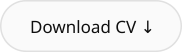</picture></a>
  <a href="https://www.linkedin.com/in/chimegdorji"><picture><source media="(prefers-color-scheme: dark)" srcset="./assets/dark/pill-linkedin.svg">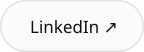</picture></a>
  <a href="https://www.chimegd.xyz"><picture><source media="(prefers-color-scheme: dark)" srcset="./assets/dark/pill-site.svg">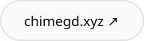</picture></a>

<picture><source media="(prefers-color-scheme: dark)" srcset="./assets/dark/marquee.svg"></picture>
<picture><source media="(prefers-color-scheme: dark)" srcset="./assets/dark/stats.svg"></picture>

 

<picture><source media="(prefers-color-scheme: dark)" srcset="./assets/dark/h-work.svg"></picture>
<a href="https://108.bt"><picture><source media="(prefers-color-scheme: dark)" srcset="./assets/dark/featured.svg"></picture></a>

  <a href="https://www.aploslab.com"><picture><source media="(prefers-color-scheme: dark)" srcset="./assets/dark/card-aplos.svg"></picture></a>
  <a href="https://zora-cyan.vercel.app"><picture><source media="(prefers-color-scheme: dark)" srcset="./assets/dark/card-zora.svg"></picture></a>

  <a href="https://www.drukhappycleaning.com"><picture><source media="(prefers-color-scheme: dark)" srcset="./assets/dark/card-druk.svg"></picture></a>
  <a href="https://zeebarresort.bt"><picture><source media="(prefers-color-scheme: dark)" srcset="./assets/dark/card-zeebar.svg"></picture></a>

Weekend build: <a href="https://thunku.vercel.app">Thunku</a>, an AI PDF summarizer shipped from idea to production in two days.

  

<picture><source media="(prefers-color-scheme: dark)" srcset="./assets/dark/h-private.svg"></picture>
<picture><source media="(prefers-color-scheme: dark)" srcset="./assets/dark/private.svg"></picture>

 

<picture><source media="(prefers-color-scheme: dark)" srcset="./assets/dark/h-experience.svg"></picture>
<picture><source media="(prefers-color-scheme: dark)" srcset="./assets/dark/experience.svg"></picture>

 

<picture><source media="(prefers-color-scheme: dark)" srcset="./assets/dark/h-awards.svg"></picture>
<picture><source media="(prefers-color-scheme: dark)" srcset="./assets/dark/awards.svg"></picture>

 

<picture><source media="(prefers-color-scheme: dark)" srcset="./assets/dark/h-stack.svg"></picture>
<picture><source media="(prefers-color-scheme: dark)" srcset="./assets/dark/stack.svg"></picture>

 

<picture><source media="(prefers-color-scheme: dark)" srcset="./assets/dark/h-cadence.svg"></picture>
<picture><source media="(prefers-color-scheme: dark)" srcset="./assets/dark/cadence.svg"></picture>

 

<a href="mailto:chimegyeltshendorji2004@gmail.com"><picture><source media="(prefers-color-scheme: dark)" srcset="./assets/dark/contact.svg"></picture></a>

<!-- Generated art: scripts/build.py (static) · scripts/cadence.py (daily via Actions). Fonts: Space Grotesk & Roboto, SIL OFL. -->
